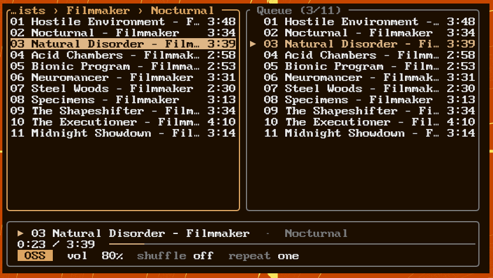

# alaska

A simple, fast terminal music player for local files and OpenSubsonic servers
(Navidrome and others), built around a file browser.

Early-stage software (0.1.x): expect rough edges and breaking changes.



## Features

- Browse the file system; playing a track queues its whole folder
- MP3, FLAC, Ogg Vorbis, Opus, M4A/AAC and WAV
- Tags (track number, title, artist, album, duration) with file-name fallback
- Editable queue, shuffle, repeat (off / all / one), seeking, volume
- Live fuzzy filter for the current directory
- OpenSubsonic mode: browse Artists → Albums → Songs, search the server,
  stream in original quality, scrobble plays
- Press `m` to switch between local and OpenSubsonic; each mode keeps its own queue
- MPRIS: media keys, `playerctl` and desktop widgets work
- Remembers volume, shuffle/repeat, queue and position between runs (resumes paused)

## Requirements

alaska runs on **Linux only**: playback uses ALSA and the MPRIS integration
needs D-Bus, so it does not build on macOS or Windows. Rust 1.89 or newer is
required.

| Distribution     | Packages                                    |
|------------------|---------------------------------------------|
| Arch             | `alsa-lib opus`                             |
| Debian / Ubuntu  | `libasound2-dev libopus-dev pkg-config`     |
| Fedora           | `alsa-lib-devel opus-devel pkgconf-pkg-config` |

## Install

```sh
cargo install --git https://github.com/alpwrk/alaska
```

This installs the `alaska` binary into `~/.cargo/bin`. (alaska is not on
crates.io yet.)

For a local checkout:

```sh
cargo build --release
./target/release/alaska [DIRECTORY]   # defaults to the current directory
```

## Keys

| Key                     | Action                                              |
|-------------------------|-----------------------------------------------------|
| `j`/`k`, `↓`/`↑`        | Move cursor                                         |
| `Ctrl-d`/`Ctrl-u`, PgDn/PgUp | Move cursor by 10                              |
| `g`/`G`                 | Top / bottom                                        |
| `l`/`Enter`/`→`         | Open directory, play track (queue: jump to track)   |
| `h`/`Backspace`/`←`     | Parent directory                                    |
| `~`                     | Home directory (OSS: artist list)                   |
| `Tab`                   | Switch focus between browser and queue              |
| `Space`                 | Play / pause                                        |
| `n` / `p`               | Next / previous track                               |
| `+` / `-`               | Volume up / down                                    |
| `.` `>` / `,` `<`       | Seek forward / backward 5 s                         |
| `s`                     | Toggle shuffle                                      |
| `r`                     | Cycle repeat: off → all → one                       |
| `/`                     | Local: filter (Enter keeps it, Esc clears it); OSS: search the server |
| `m`                     | Switch between local and OpenSubsonic mode          |
| `L`                     | OpenSubsonic login (change server or user)          |
| `Esc`                   | Clear filter                                        |
| `d`                     | Remove track from queue (queue focus)               |
| `J` / `K`               | Move track down / up in queue (queue focus)         |
| `q`                     | Quit                                                |

## OpenSubsonic

The first `m` opens a login dialog (server URL, username, password). After a
successful login the credentials are saved to `~/.config/alaska/config.toml`
(mode 600) and the next `m` connects directly:

```toml
[subsonic]
url = "https://music.example.com"
user = "me"
password = "secret"
```

Requests use Subsonic token authentication (salted MD5), so the password itself
is never sent to the server. Switching modes pauses the current one; switching
back resumes it paused at the same position.

## Privacy

alaska has no telemetry and talks only to the OpenSubsonic server you configure.
Credentials are stored in plain text in `~/.config/alaska/config.toml` (mode
600), so anyone who can read your home directory can read the password; use a
dedicated Subsonic user if that matters to you.

## Files

- `~/.config/alaska/config.toml` – OpenSubsonic login
- `~/.local/state/alaska/state.json` – volume, modes, both queues and positions
- `~/.cache/alaska/tags.json` – tag cache (invalidated by file modification time)
- `~/.cache/alaska/stderr.log` – library warnings printed while the TUI runs

## License

MIT. See [LICENSE](LICENSE).
